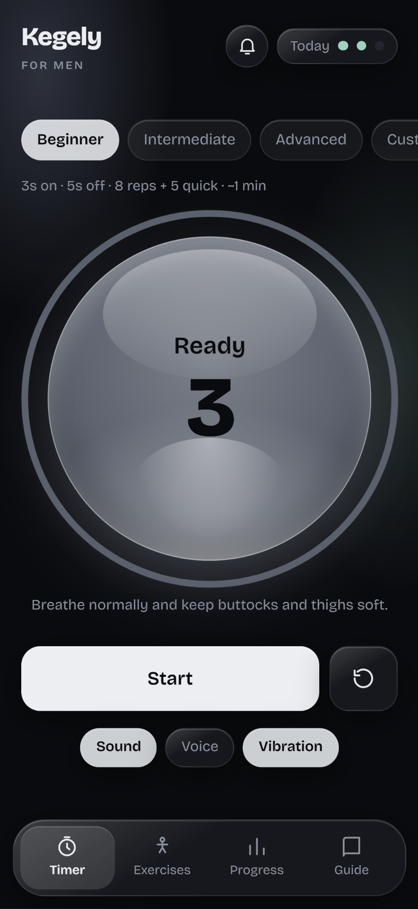
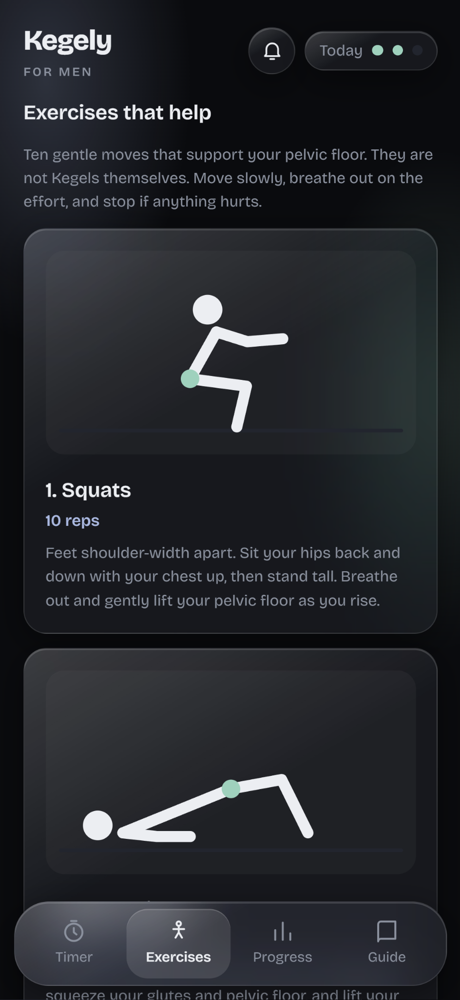
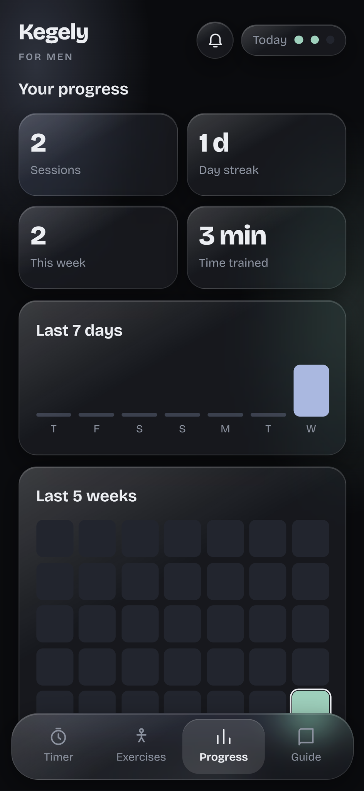
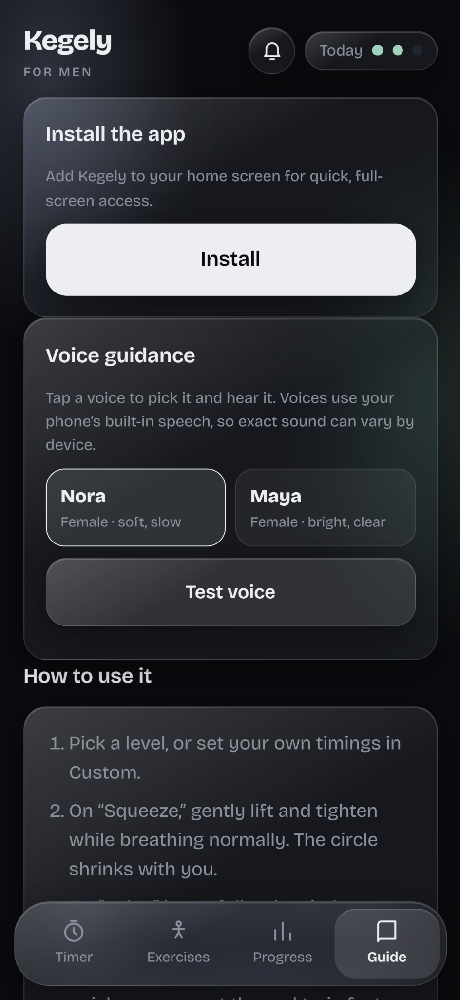
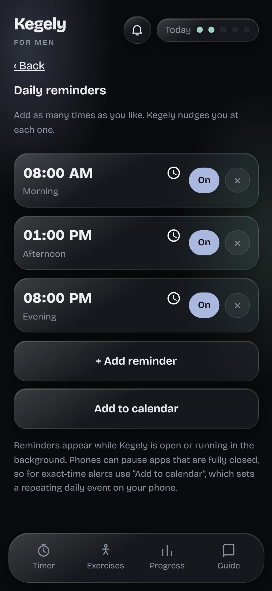

# Kegely for Men

### A simple, private pelvic floor trainer.

A free, mobile-friendly Kegel training app for men — with a guided timer, supporting exercises, progress tracking and practical guidance.

[**Open Kegely**](https://flikx-labs.github.io/Kegely/) · [Install on your phone](#install-the-app) · [How it works](#how-to-use-kegely)

---

## Screenshots

  
  &nbsp;&nbsp;
  
  &nbsp;&nbsp;
  

  
  &nbsp;&nbsp;
  

## Features

- **Guided training timer** — a visual breathing orb, countdown and progress ring guide each squeeze and relaxation phase.
- **Flexible training levels** — choose Beginner, Intermediate, Advanced or create a Custom routine with your own timings and repetitions.
- **Multiple cues** — enable or disable sound, voice guidance and vibration.
- **Supporting exercises** — ten gentle movements, including squats, glute bridges, bird dogs and child's pose. These complement pelvic floor training; they are not Kegels themselves.
- **Progress tracking** — view completed sessions, daily streak, weekly activity, time trained, a 7-day chart and a 5-week activity grid.
- **Daily reminders** — add multiple reminder times and manage each one individually.
- **Voice guidance** — choose between Nora and Maya. Speech uses the voices available on your device.
- **Practical guide** — learn how to find the right muscles, avoid common mistakes and build up gradually.
- **Installable PWA** — add Kegely to your phone's home screen and use its offline app experience.
- **Light and dark themes** — follows your device's appearance setting.

## Try it

**Live app:** https://flikx-labs.github.io/Kegely/

No account or sign-up is needed. Open the link in your browser to get started.

## Install the app

Kegely is a Progressive Web App (PWA), so you can add it to your home screen.

- **iPhone / iPad:** Open the site in Safari, tap **Share**, then choose **Add to Home Screen**.
- **Android:** Open the site in Chrome and choose **Install app** from the browser menu or the install prompt.

For the best experience, open the app in your device's main browser rather than an in-app browser.

## Privacy

Kegely is designed to work without an account or backend. Training history, preferences and reminders are stored locally in your browser on your device. There is no user account or analytics system.

The app may request notification permission when you enable reminders. Voice guidance uses your browser/device's built-in speech synthesis.

## Reminders: an important note

Browser reminders can appear while Kegely is open or running in the background. Mobile operating systems may pause a fully closed browser app, so browser notifications are not guaranteed to fire at an exact time in that situation.

For more reliable scheduled alerts, use **Add to calendar** on the reminders screen. This adds repeating daily events to your phone's calendar.

## How to use Kegely

1. Choose a training level or configure your own timings.
2. During **Squeeze**, gently lift and tighten your pelvic floor while breathing normally.
3. During **Relax**, release fully before the next repetition.
4. Complete the slow holds and quick squeezes at a comfortable pace.
5. Use the Exercises and Guide sections for supporting movements and technique advice.
6. Check Progress to follow your consistency over time.

Keep your stomach, thighs and buttocks relaxed. Avoid holding your breath, and do not squeeze as hard as possible.

## Medical disclaimer

Kegely is an educational fitness tool, not medical advice or a substitute for professional care. Kegel exercises are not suitable for everyone. If you have pelvic pain, pain during sex, difficulty relaxing these muscles, urinary symptoms, or a history of prostate or pelvic surgery, speak with a doctor or pelvic floor physiotherapist before starting. Stop if anything hurts or symptoms get worse.

## Built with

Kegely is a lightweight web app built with standard web technologies and delivered as a Progressive Web App. It is hosted on **GitHub Pages**.

---

Made to make consistent pelvic floor training simpler.

[**Launch Kegely →**](https://flikx-labs.github.io/Kegely/)

